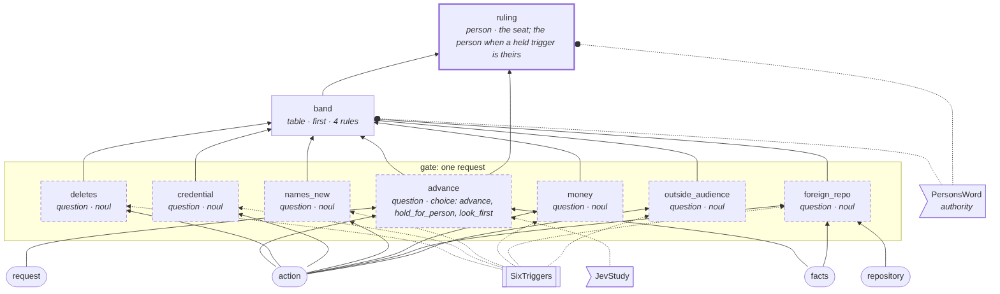

# advance-gate: a decision model and its recorded runs

The first document of the loom's decision model format (`rispecs/85-dmdf-decision-model.spec.md`,
jgwill/smcraft#32). It is Episode 564's advance gate: a seat working on its own asks a decision
engine "shall I advance with this action?" before an act it would otherwise decide alone.

| file | what it is |
|---|---|
| `advance-gate.dmdf.json` | the model, written to version 0.2 of the format |
| `advance-gate.dmd.mmd`, `.dmd.png` | its drawing, as `render_diagram` writes it (the png by mermaid-cli) |
| `ledger-261114.jsonl` | the ledger of 2026-11-14: 16 lines, of which 7 runs, 8 rulings and 1 withdrawal |
| `advance-gate.draft-0.1.dmdf.json` | the first drawing, written by hand to version 0.1, unchanged |



## Where it came from

Copied on 2026-11-18 from Episode 564 of the Miadi chronicle,
`2026-10-26-episode-564-jev-decides-with-the-factory/advance-gate-261114/`, at chronicle commit
`6e869041`. The episode's files are not changed by this copy.

- `advance-gate.draft-0.1.dmdf.json` is `advance-gate.dmdf.json` of the episode, byte for byte
  (sha256 `2e597335…e7737257`).
- `ledger-261114.jsonl` is the episode's ledger (sha256 `783b4b67…1870ea76`) **without its free
  text**. This repository is public, and each line's `action`, `request`, `facts` and `words`
  name people, mailboxes and accounts. Those four fields were left out, with `repository`,
  `run_id` and `paid_input_tokens`. Every number, every id, every recorded band and every ruling
  is as it was written. The replay reads none of the fields left out.
- `advance-gate.dmdf.json` is written here. Its questions, option texts and band are the ones
  `advance-gate.mjs` (the episode's script, questions 0.1.0) sent that day. The six trigger
  questions and their criteria are `TRIGGERS` of
  `claude/miadi-witness/scripts/choose-worker.mjs` in jgwill/miadi-orchestration-kit at `1b954cb`,
  reading `action` where they read `task`, as the script did.

## What the replay shows

No engine is asked. With the MCP server on `advance-gate.dmdf.json`:

```
validate_decision_model      → Decision model 'AdvanceGate' 0.1.0 is valid.
replay_decision_ledger       → 7 of 7 run(s) replayed: 7 give what was recorded, 0 differ
```

| run | band, replayed | rule | recorded |
|---|---|---|---|
| ag-20261114180612587 | hold_for_person | 1 | hold_for_person |
| ag-20261114180623843 | seat_reads | 4 | seat_reads |
| ag-20261114181630897 | hold_for_person | 1 | hold_for_person |
| ag-20261114182215678 | hold_for_person | 1 | hold_for_person |
| ag-20261114183703040 | hold_for_person | 2 | hold_for_person |
| ag-20261114185258305 | hold_for_person | 1 | hold_for_person |
| ag-20261114185304783 | hold_for_person | 1 | hold_for_person |

Seven rulings are in force and one was withdrawn. One ruled as the band did, six against it.
Six ruled as the engine's choice did, one against it. Twenty rulings are the count after which a
person may set a bar.

## What the ledger does not hold

- **A verdict on the band, on the first four rulings** (lines 2, 4, 6 and 8). They recorded a
  verdict on the engine's choice only (Episode 564, J5). The replay compares each ruling with the
  band itself. It does not write the missing field.
- **The request each run sent.** A line keeps the first 500 characters of `action`, `request`
  and `facts`, and one run's `facts` reaches that length (`ag-20261114185258305`), so its state
  cannot be rebuilt in full. The tests check what can be: the seven questions, the state's four
  keys, and the option order each line recorded.
- **Who set the bars.** The script holds them as constants. The model writes them with
  `calibrated_from: 0` and no `set_by`.

## What 0.1 lacked

`validate_decision_model` on `advance-gate.draft-0.1.dmdf.json` reports 9 problems and 2 warnings:
no version (D012), no criterion on six nouls (D009), a rule whose outcome is "the advance choice"
(D006), no failure route (D015), a table written in words only (D020, a warning) and the engine's
model in `settings` (D017, a warning). The loom still reads and draws it. It does not run its table.
